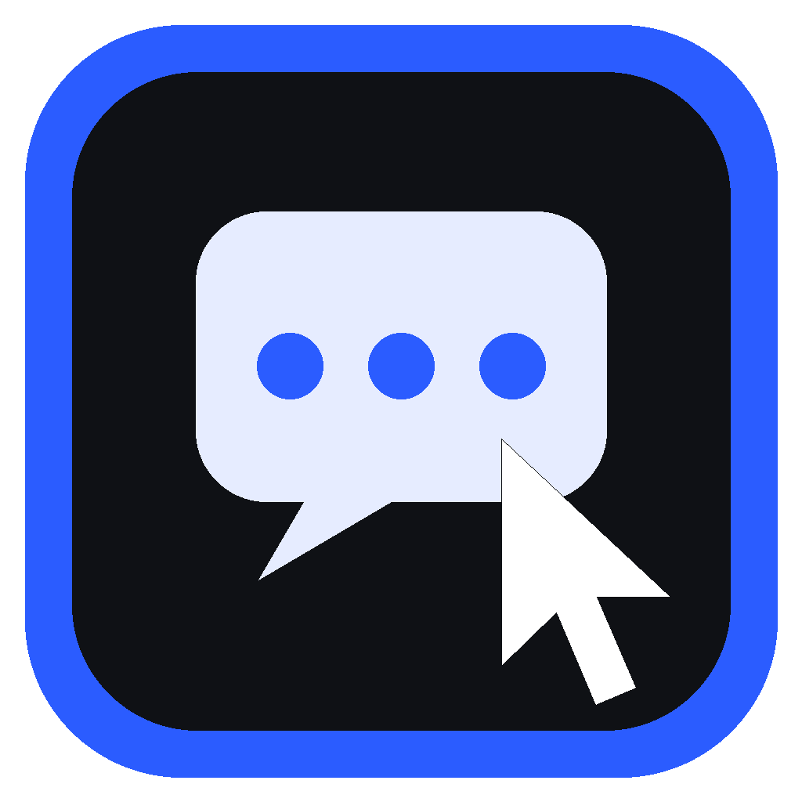
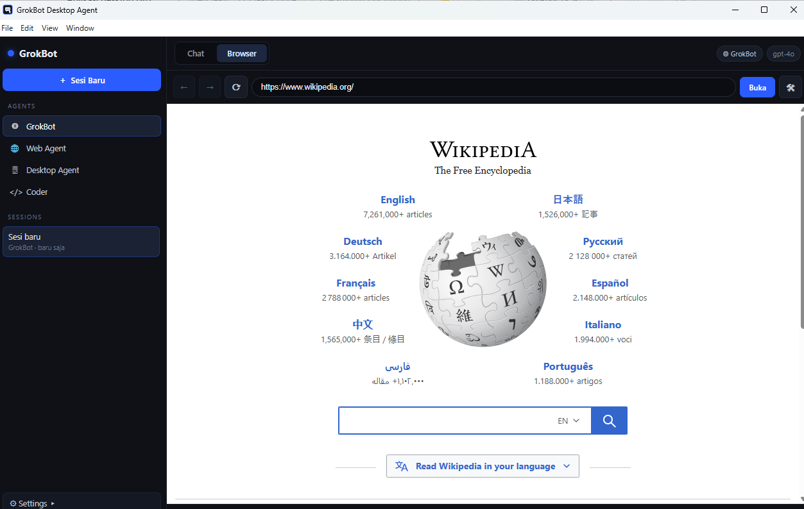
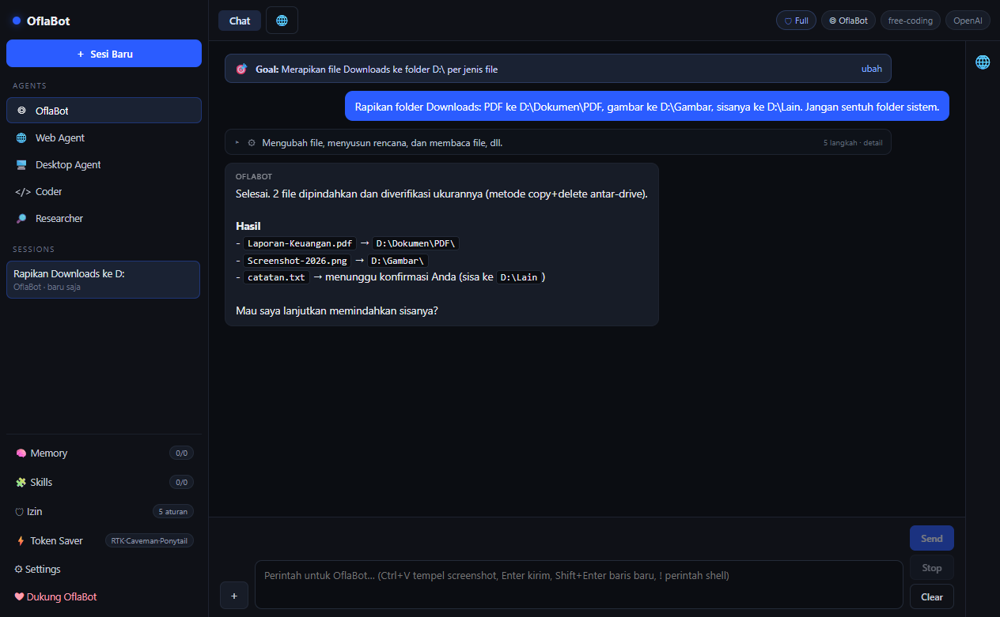

# OflaBot

<p align="center">
  
</p>

<p align="center">
  <b>AI desktop agent untuk Windows</b> — browser tertanam, memory & auto-skill,
  install skill dari GitHub, dan dukungan banyak provider AI.
</p>

<p align="center">
  <a href="https://github.com/VorElze/OflaBot/stargazers"></a>
  <a href="LICENSE"></a>
  
</p>

---

## ⬇️ Download

Rilis siap pakai (installer Windows):
**[github.com/VorElze/OflaBot/releases](https://github.com/VorElze/OflaBot/releases/latest)**

1. Unduh `OflaBot-Setup-<versi>.exe`
2. Jalankan installer — jika muncul **"Windows protected your PC"**, klik
   **More info → Run anyway** (aplikasi belum code-signing).
3. Shortcut **OflaBot** dibuat di Desktop & Start Menu.

Verifikasi unduhan dengan file `.sha256` yang disertakan di halaman rilis.

## ✨ Fitur

| Fitur | Keterangan |
|---|---|
| 🌐 **Browser tertanam** | Semua navigasi web terjadi **di dalam aplikasi** (bukan Edge/Chrome). Agent bisa membuka URL, membaca isi halaman, klik, isi form, dan screenshot halaman. |
| 🤖 **Agents** | `OflaBot`, `Web Agent`, `Desktop Agent`, `Coder`, `Researcher` — masing-masing punya set tool sendiri. |
| 🗂 **Sessions** | Riwayat percakapan tersimpan otomatis, bisa dibuat/dipindah/dihapus. |
| 🧠 **Memory jangka panjang** | Agent menyimpan fakta & preferensi penting dan memakainya lagi di sesi berikutnya. |
| 🎓 **Belajar skill otomatis** | Setelah sesi, agent merefleksikan percakapan dan menyimpan prosedur yang bisa dipakai ulang (gaya Hermes). Bisa dimatikan di Settings. |
| 🧩 **Skill dari GitHub** | Pasang skill `SKILL.md` dari repo mana pun — kompatibel dengan skill Claude Code / Claude Desktop / Codex / OpenCode / Hermes / VS Code. Bisa juga impor dari folder lokal. |
| 🔀 **Dropdown model otomatis** | Daftar model dibaca langsung dari API provider — tidak perlu mengetik nama model. |
| 🖥 **Kontrol desktop** | Jalankan perintah, buka aplikasi, mouse, keyboard, baca/tulis file (dengan konfirmasi untuk aksi berbahaya). |
| ❤ **Donasi** | Menu dukungan langsung ke [Saweria](https://saweria.co/OflaCo). |





## 🔌 Provider yang didukung

| Provider | Protokol | Daftar model |
|---|---|---|
| OpenAI, DeepSeek, Groq, OpenRouter, MiniMax, NVIDIA NIM, Gemini, 9Router, Custom | OpenAI-compatible | `GET {base}/models` |
| Anthropic, **Syncera.id (Anthropic)**, Claude Code | Anthropic | `GET /v1/models` |
| **Syncera.id (Codex)** | OpenAI-compatible | `GET {base}/models` |
| **OpenCode Console (Free)** | OpenAI-compatible | `https://opencode.ai/inference/openai/v1` |
| **opencode-go (Subscription)** | OpenAI-compatible | endpoint yang sama, API key langganan |
| Ollama (lokal) | OpenAI-compatible | `GET /api/tags` |

Kalau provider tidak menyediakan endpoint daftar model, OflaBot memakai daftar
cadangan dan tetap menyediakan mode **ketik manual**.

## 📦 Build sendiri

Prasyarat: **Node.js 20+** dan Windows 10/11.

```bash
git clone https://github.com/VorElze/OflaBot.git
cd OflaBot
npm install
npm run dev        # mode pengembangan (Vite + Electron)
```

Membuat installer `.exe`:

```bash
npm run dist       # -> release\OflaBot-Setup-<versi>.exe
```

Catatan build:

- Installer dibuat dengan **.NET (`csc.exe`)**, bukan NSIS — NSIS gagal pada
  beberapa build Windows.
- Shortcut menunjuk `wscript.exe` → `launch.vbs` supaya aplikasi tidak diblokir
  dialog **SmartScreen** ("Windows protected your PC").
- Aplikasi dijalankan dengan `--no-sandbox` (dibutuhkan Chromium di sebagian
  build Windows). Kalau menjalankan exe langsung, tambahkan flag itu.

## 🧩 Contoh memasang skill dari GitHub

1. Buka panel **Skills** di sidebar.
2. Tempel `owner/repo` atau `https://github.com/owner/repo` (boleh dengan
   `/tree/branch/folder`).
3. Klik **Install** — OflaBot mengunduh semua `SKILL.md` dan mendaftarkannya.
4. Atau klik **Import dari folder lokal** untuk memindai:
   `~/.claude/skills`, `~/.claude/plugins`, `~/AppData/Roaming/Claude/skills`,
   `~/.config/opencode/skills`, `~/.codex/skills`, `~/.hermes/skills`,
   `~/.vscode/skills`, dan `.claude/skills` di folder kerja.

Format skill yang dibaca:

```markdown
---
name: contoh-skill
description: Kapan skill ini dipakai
---

# Langkah-langkah
1. ...
2. ...
```

## 🗂 Struktur proyek

```
electron/main.ts     window, IPC provider, browser tertanam, memory, skills, model list
electron/preload.ts  bridge aman (contextIsolation)
src/App.tsx          UI: sidebar Agents/Sessions, tab Chat & Browser, panel Memory/Skills/Donasi
src/agents.ts        definisi Agent + aturan memory/skill
src/agent.ts         definisi & eksekutor tool
src/providers.ts     katalog provider + default model
src/styles.css       tema gelap
installer/Setup.cs   installer .NET (payload ter-embed)
build/               ikon aplikasi
build-exe.ps1        skrip build installer
```

## 🔐 Privasi & keamanan

- API key hanya disimpan lokal di profil aplikasi (`localStorage`), tidak
  dikirim ke mana pun selain provider yang Anda pilih.
- Aksi desktop berbahaya (exec, tulis file, launch, mouse/keyboard) meminta
  konfirmasi lebih dulu.
- Skill dari GitHub diunduh sebagai teks (`SKILL.md`) dan hanya dibaca agent;
  **periksa dulu** isi skill sebelum mengaktifkannya.

## ❤ Dukungan

Kalau OflaBot membantu pekerjaan Anda:
**[saweria.co/OflaCo](https://saweria.co/OflaCo)**

## 📄 Lisensi

[MIT](LICENSE)

## ?? Mode akses (Full Access)

- Toolbar kanan: tombol **?? Normal / ?? Full Access** — klik untuk berganti.
- **Settings ? Full Access** juga tersedia.
- Mode Normal: dialog izin muncul sekali; klik **Allow** lalu semua aksi berikutnya
  di sesi itu otomatis diizinkan. Klik **Cancel** untuk menolak aksi tersebut.

## ?? Uninstall menyeluruh

Jalankan `uninstall.cmd` di folder instalasi (atau Start Menu ? OflaBot ? Uninstall).
Yang dihapus: proses aplikasi, shortcut Desktop + Start Menu, entri registry,
folder instalasi, serta cache/profil (`%APPDATA%\OflaBot`,
`%APPDATA%\grokbot-desktop`, `%LOCALAPPDATA%\OflaBot`).
## ?? Keandalan agent (v0.2.3)

Berdasarkan pembandingan dengan artefak OpenCode Desktop (`app.asar`: tool `todowrite`,
kompaksi konteks, penanganan `tool-error`) dan perilaku agent GrokBot:

- **Pengaman loop**: panggilan tool dengan nama+argumen sama ke-3× tidak dieksekusi;
  agent diberi instruksi untuk mengubah pendekatan / bertanya. (Diuji dengan mock
  provider yang selalu memanggil tool sama: berhenti di 3 panggilan, lanjut jawaban final.)
- **Retry provider** otomatis 3× untuk error transien (429/5xx/timeout).
- **Respons kosong** tidak lagi menjadi bubble "(tanpa jawaban)" — muncul notifikasi jelas.
- **Batas langkah 26** + tombol **? Lanjutkan**.
- **Tool file native** (menggantikan pola shell loop): `file_list`, `file_move`,
  `file_mkdir`, `file_stat`.
- **Todo/rencana tugas** (`todo_write`) tampil sebagai panel ?? — agent wajib memakainya
  untuk tugas multi-langkah.
- **exec** kini punya `timeoutMs` (default 120s) dan `cwd`, output dipotong 200 KB
  dengan penanda `truncated`/`timedOut`.
## ➕ Menu composer (v0.2.5)

Tombol **＋** di kotak pesan (mirip DSH):

| Add | Fungsi |
|---|---|
| 📎 File (Ctrl+U) | lampirkan gambar (vision) atau file teks (konteks) |
| 🎯 Goal | tujuan jangka panjang sesi (banner, selalu diingat model) |
| 🗒 Plan | mode rencana: hanya menyusun langkah, tidak mengubah apa pun |
| 💬 Feedback | rating ★ + catatan, tersimpan lokal |

| Commands | Fungsi |
|---|---|
| ◐ Compact | ringkas riwayat lama agar context hemat |
| 🛡 Permission | Read Only / Workspace Write / Full access |
| 🧠 Model | pilih model (dropdown dari API provider) |
| ⬇ Export | simpan log sesi (Markdown/JSON/ZIP) |
| ▸ Shell command | jalankan perintah tanpa AI |