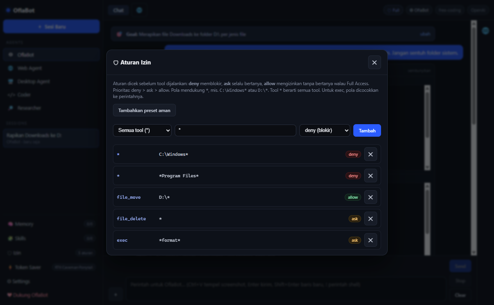
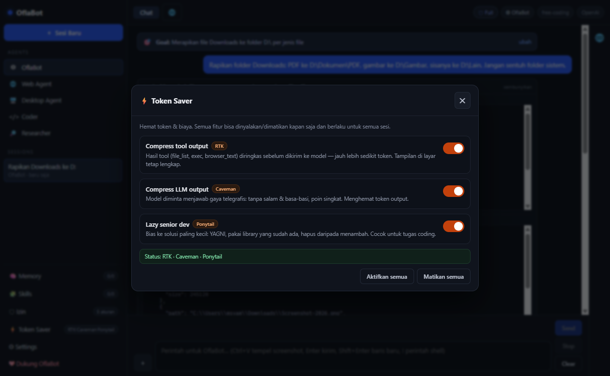
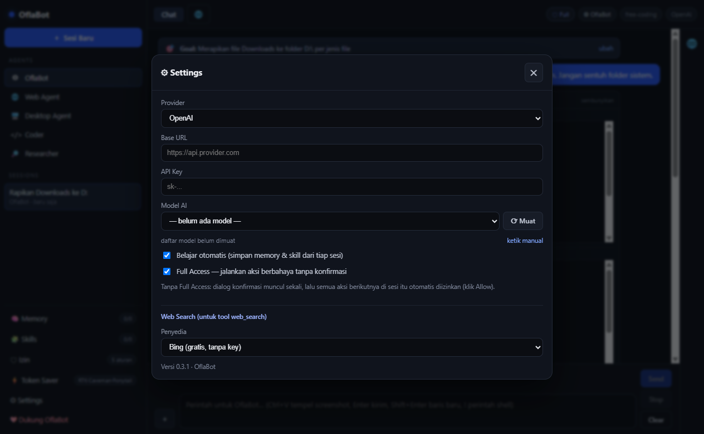
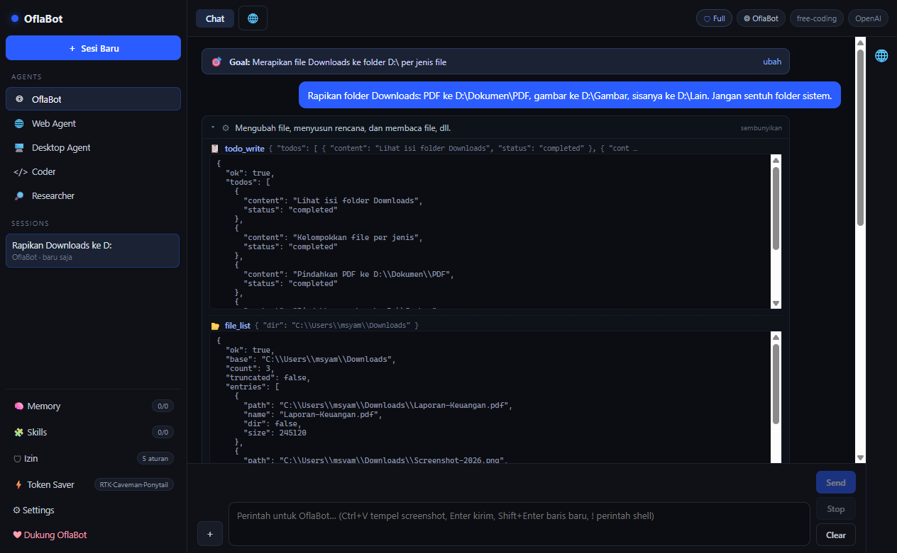

# OflaBot

<p align="center">
  
</p>

<p align="center">
  <b>AI desktop agent untuk Windows</b> — browser tertanam, tool file lengkap, web search,
  sub-agent paralel, izin granular, antrian chat, dan dukungan banyak provider AI.
</p>

<p align="center">
  <a href="https://github.com/VorElze/OflaBot/releases/latest"></a>
  <a href="https://github.com/VorElze/OflaBot/stargazers"></a>
  <a href="LICENSE"></a>
  
</p>

---

## ✨ Sekilas

- **Agent yang benar-benar mengoperasikan komputer**: baca/cari/ubah/pindah/hapus file, jalankan
  perintah (cmd/PowerShell), buka aplikasi, kontrol mouse & keyboard, dan browser tertanam.
- **Tidak berputar-putar**: tool call digabung jadi satu kartu, hasil berulang dipakai dari cache,
  dan ada pengaman yang hanya berhenti kalau pekerjaan benar-benar macet.
- **Bisa Anda arahkan di tengah jalan**: kirim pesan **antrian** saat agent bekerja.
- **Aman**: aturan izin granular + proteksi folder sistem + konfirmasi untuk aksi berbahaya.

<p align="center">
  
</p>

## ⬇️ Download

Rilis siap pakai:
**[github.com/VorElze/OflaBot/releases/latest](https://github.com/VorElze/OflaBot/releases/latest)**

1. Unduh `OflaBot-Setup-<versi>.exe`
2. Jalankan installer — jika muncul **"Windows protected your PC"**, klik
   **More info → Run anyway** (aplikasi belum code-signing).
3. Shortcut **OflaBot** dibuat di Desktop & Start Menu.

Verifikasi unduhan dengan file `.sha256` di halaman rilis.

## 🚀 Fitur

### Agent & otomasi
| Fitur | Keterangan |
|---|---|
| 🌐 **Browser tertanam** | Navigasi web di dalam aplikasi (bukan Edge/Chrome): buka URL, baca isi, klik, isi form, screenshot halaman. |
| 📥 **Unduhan & PDF** | File dari tombol Export/Unduh disimpan ke folder Downloads + path diberitahukan. Bisa juga simpan halaman jadi PDF (print-to-PDF). |
| 🖥 **Kontrol desktop** | Jalankan perintah (cmd/PowerShell), buka aplikasi, mouse, keyboard, dengan izin. |
| 📁 **Tool file lengkap** | `file_list`, `file_glob`, `file_search` (grep), `file_read` (offset/limit), `file_edit`, `file_write`, `file_copy`, `file_move`, `file_delete`, `file_mkdir`, `apply_patch` (multi-file + backup/rollback). |
| 🔎 **Web search** | DuckDuckGo/Bing gratis, atau Tavily/Brave/SearXNG dengan API key. |
| 👥 **Sub-agent paralel** | Pecah riset/pembacaan jadi maks 4 sub-agent yang jalan bersamaan (read-only). |
| 🧠 **Memory & skill** | Ingat fakta/preferensi; belajar prosedur dari sesi; pasang skill `SKILL.md` dari GitHub atau folder lokal. |
| 🗂 **Sessions & Goal** | Riwayat tersimpan otomatis, bisa dihapus/dipindah; goal sesi selalu diingat agent. |
| 🔀 **Multi-provider** | OpenAI-compatible + Anthropic-style, dropdown model otomatis dari API. |

### Keandalan & keamanan
| Fitur | Keterangan |
|---|---|
| 🛡 **Izin granular** | Aturan `deny`/`ask`/`allow` per tool + pola path/perintah. Contoh: `*` + `C:\Windows*` = deny, `file_move` + `D:\*` = allow, `exec` + `*format*` = ask. |
| 🔒 **Proteksi folder sistem** | Windows, Program Files, ProgramData, AppData, Recovery tidak bisa dipindah/dihapus otomatis. |
| 🔁 **Anti-duplikat & cache** | Perintah setara (variasi kutipan/shell) tidak dijalankan ulang. |
| 📊 **Pengaman macet** | Berhenti hanya saat langkah benar-benar sia-sia (duplikat/error/timeout), bukan sekadar jumlah langkah. |
| 🧹 **Auto-compaction** | Riwayat lama diringkas otomatis agar percakapan tetap ringkas dan hemat konteks. |
| 🧾 **Tool `session_log`** | Agent bisa membaca log sesinya sendiri saat Anda minta laporan/progres. |
| ❓ **Tool `ask_user`** | Agent bertanya lewat modal dan menunggu jawaban saat tugas ambigu. |

### UI & kenyamanan
| Fitur | Keterangan |
|---|---|
| ⏳ **Antrian chat (steer)** | Tetap bisa kirim pesan saat agent bekerja; pesan disuntik di langkah berikutnya. |
| 🧩 **Grouping ala IDE** | 12+ tool call berurutan jadi satu kartu dengan judul kategori; detail bisa dibuka. |
| 🖼 **Ctrl+V gambar** | Tempel screenshot (Win+Shift+S → Ctrl+V) langsung ke chat. |
| ⚡ **Token Saver** | Compress tool output (RTK), Compress LLM output (Caveman), Lazy senior dev (Ponytail) — bisa on/off. |
| 📋 **Todo otomatis** | Tugas multi-langkah otomatis dibuatkan rencana dan progresnya. |
| ❤ **Donasi** | Dukungan via [Saweria](https://saweria.co/OflaCo). |

## 🖼️ Tampilan

| Browser tertanam | Aturan izin |
|---|---|
|  |  |

| Token Saver | Settings (web search) |
|---|---|
|  |  |

<p align="center">
  
</p>

## 🧑‍💻 Cara pakai singkat

1. Buka **⚙ Settings** → pilih provider → isi **API Key** → pilih **Model**.
2. Minta dengan bahasa biasa, mis. *"Rapikan folder Downloads: PDF ke D:\Dokumen\PDF,
   gambar ke D:\Gambar, sisanya ke D:\Lain. Jangan sentuh folder sistem."*
3. Untuk tugas web: *"Buka https://situs.example, login, buka menu laporan, klik Export,
   lalu beri tahu lokasi file PDF-nya."*

Tips:
- Di tengah pekerjaan, ketik pesan tambahan lalu klik **Antrikan**.
- Kalau ingin mengatur izin, buka **🛡 Izin** → **Tambahkan preset aman**.
- Kalau model berhenti, agent akan memberi ringkasan; Anda bisa lanjut dengan instruksi baru.

## 🔌 Provider yang didukung

| Provider | Protokol | Daftar model |
|---|---|---|
| OpenAI, DeepSeek, Groq, OpenRouter, MiniMax, NVIDIA NIM, Gemini, 9Router, Custom | OpenAI-compatible | `GET {base}/models` |
| Anthropic, Syncera.id (Anthropic), Claude Code | Anthropic | `GET /v1/models` |
| Syncera.id (Codex) | OpenAI-compatible | `GET {base}/models` |
| OpenCode Console (Free) | OpenAI-compatible | `https://opencode.ai/inference/openai/v1` |
| opencode-go (Subscription) | OpenAI-compatible | endpoint yang sama, API key langganan |
| Ollama (lokal) | OpenAI-compatible | `GET /api/tags` |

Jika provider tidak menyediakan endpoint daftar model, OflaBot memakai daftar cadangan dan
tetap menyediakan mode **ketik manual**.

## 📦 Build sendiri

Prasyarat: **Node.js 20+** dan Windows 10/11.

```bash
git clone https://github.com/VorElze/OflaBot.git
cd OflaBot
npm install
npm run dev        # mode pengembangan (Vite + Electron)
npm run dist       # -> release\OflaBot-Setup-<versi>.exe
```

Catatan build:
- Installer dibuat dengan **.NET (`csc.exe`)**, bukan NSIS.
- Shortcut menunjuk `wscript.exe` → `launch.vbs` untuk menghindari dialog SmartScreen.
- Aplikasi berjalan dengan `--no-sandbox` (dibutuhkan Chromium di sebagian build Windows).

Opsional untuk kontributor/AI agent — indeks kode (graphify):

```bash
npm run graph:update     # butuh graphify CLI
graphify explain "agentLoop"      # siapa memanggil apa
graphify affected "toolSignature" # dampak perubahan
```

Hasil indeks ada di `graphify-out/` dan tidak di-commit.

## 🗂 Struktur proyek

```
electron/main.ts     window, IPC provider, browser tertanam, unduhan, memory, skills, tool FS,
                     web search, patch, model list, smoke test
electron/preload.ts  bridge aman (contextIsolation)
src/App.tsx          UI: sidebar Agents/Sessions, chat, browser, panel Izin/Settings/Memory/Skills,
                     antrian chat, agent loop + pengaman
src/agents.ts        definisi Agent + aturan kerja/memory/skill
src/agent.ts         definisi & eksekutor tool
src/providers.ts     katalog provider + default model
src/styles.css       tema gelap
installer/Setup.cs   installer .NET (payload ter-embed) + uninstaller
build-exe.ps1        skrip build installer
```

## 🔐 Privasi & keamanan

- API key hanya disimpan lokal di profil aplikasi (`localStorage`), tidak dikirim ke mana pun
  selain provider yang Anda pilih.
- Aksi berbahaya (exec, tulis/hapus file, launch, mouse/keyboard) mengikuti aturan izin.
- Skill dari GitHub diunduh sebagai teks (`SKILL.md`) dan hanya dibaca agent.

## 🧹 Uninstall menyeluruh

Jalankan `uninstall.cmd` di folder instalasi (atau Start Menu → OflaBot → Uninstall).
Yang dihapus: proses aplikasi, shortcut Desktop + Start Menu, entri registry, folder instalasi,
serta cache/profil (`%APPDATA%\OflaBot`, `%APPDATA%\grokbot-desktop`, `%LOCALAPPDATA%\OflaBot`).

## ❤ Dukungan

Kalau OflaBot membantu pekerjaan Anda:
**[saweria.co/OflaCo](https://saweria.co/OflaCo)**

## 📄 Lisensi

[MIT](LICENSE)

---

<p align="center">
  <sub>Versi stabil terakhir: <b>v0.3.1</b> · <a href="https://github.com/VorElze/OflaBot/releases">semua rilis</a></sub>
</p>
